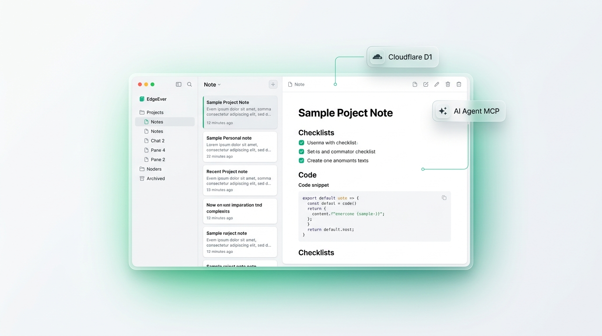
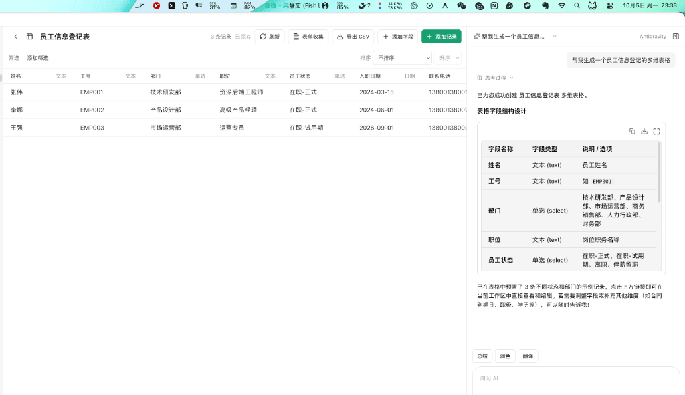
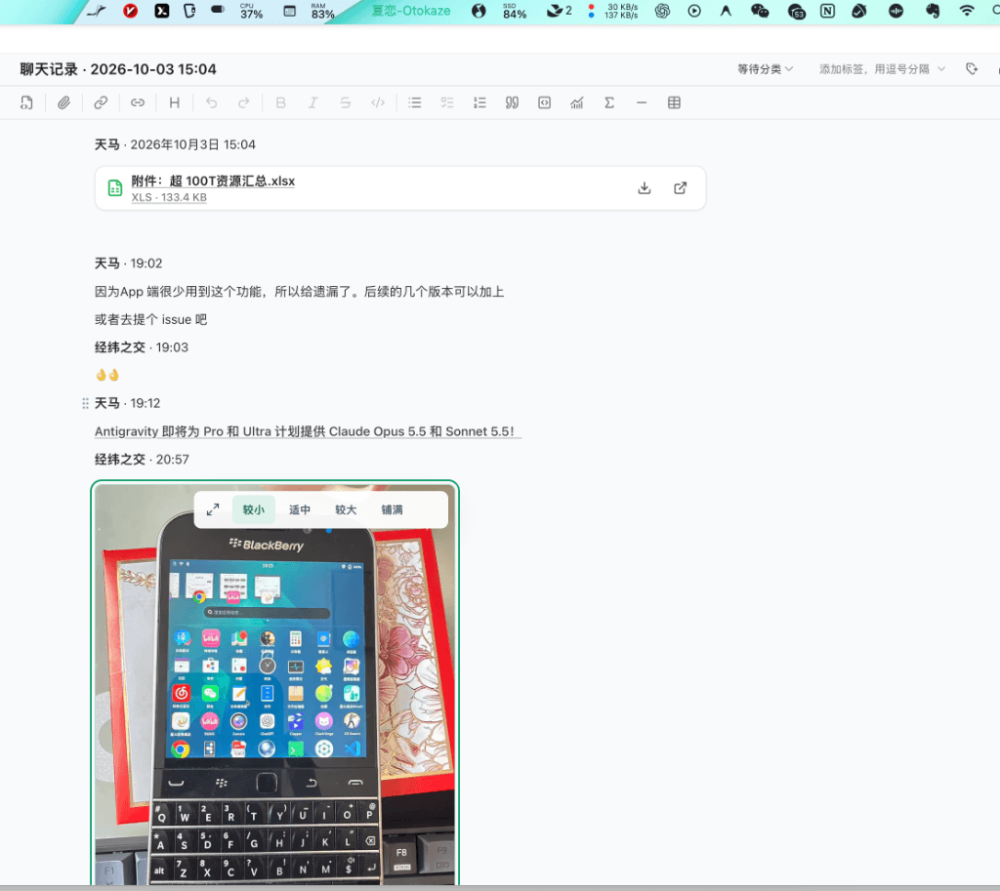
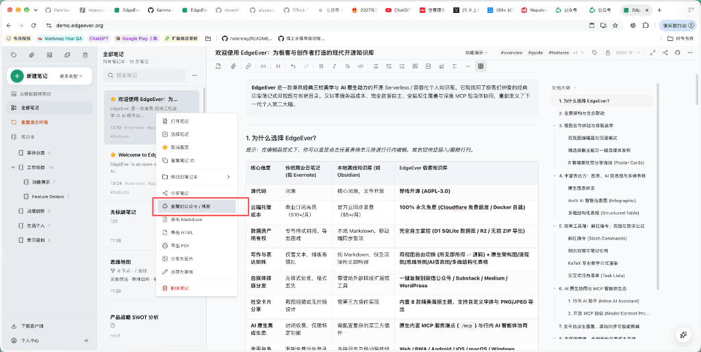

<div align="center">
  <h1>
     EdgeEver
  </h1>
  <p>
    <b>Natywna dla AI baza wiedzy oraz alternatywa dla Evernote/Obsidian z błyskawiczną synchronizacją i natywnym MCP. Bezpłatnie na Cloudflare lub self-hosted przez Docker.</b>
  </p>
  <p>
    <a href="https://github.com/tianma-if/edgeever/stargazers"></a>
    <a href="https://github.com/tianma-if/edgeever/network/members"></a>
    <a href="https://github.com/tianma-if/edgeever/pkgs/container/edgeever"></a>
    <a href="https://www.producthunt.com/products/edgeever?utm_source=other&utm_medium=social"></a>
    <a href="https://hellogithub.com/repository/tianma-if/edgeever" target="_blank"></a>
    <a href="#wsparcie-projektu"></a>
  </p>
  <p>
    <a href="README.zh-CN.md">简体中文</a> | <a href="README.zh-TW.md">繁體中文</a> | <a href="README.md">English</a> | <a href="README.ja.md">日本語</a> | <b>Polski</b>
  </p>
  <p>
    <a href="https://t.me/+wwUx1BYLrIdiZjY1"> Grupa na Telegramie</a> &nbsp;|&nbsp;
    <a href="https://demo.edgeever.org">🌐 Demo na żywo</a> &nbsp;|&nbsp;
    <a href="#aplikacje-i-rozszerzenia">📱 Aplikacje i rozszerzenia</a> &nbsp;|&nbsp;
    <a href="#features">Najważniejsze funkcje i zastosowania</a>
  </p>
  <p>
    
  </p>
</div>

EdgeEver to nowoczesna, otwartoźródłowa przestrzeń do notatek i zarządzania wiedzą. Zachowuje wygodę klasycznego, wysoce efektywnego układu trzech paneli (drzewo katalogów · lista notatek · edytor), a jednocześnie daje kontrolę nad danymi i bezpośrednią współpracę z agentami AI.

> 💡 **Bez serwera i bez opłat w ramach darmowego planu**
> EdgeEver może działać w darmowym planie Cloudflare, bez kupowania i utrzymywania serwera. Jeśli wolisz VPS, NAS lub serwer domowy, tę samą aplikację możesz wdrożyć przez Dockera.

> ⭐ Jeśli EdgeEver Ci się przydaje, zostaw gwiazdkę na GitHubie. Dzięki temu więcej osób znajdzie projekt.

## Dlaczego EdgeEver?

Wielu użytkowników **aplikacji do notatek i osobistych baz wiedzy** szuka po prostu **niezawodnej, otwartej i szybkiej** osobistej bazy wiedzy. Popularne rozwiązania mają jednak swoje ograniczenia:

| Typ rozwiązania | Przykładowe aplikacje | Układ i doświadczenie użytkownika | Synchronizacja i koszt hostingu | Ekosystem AI i agentów |
| :--- | :--- | :--- | :--- | :--- |
| **Komercyjne notatki w chmurze** | Evernote | Klasyczny układ 3 paneli, rozbudowany i ciężki | Ograniczany darmowy plan, drogi abonament | Zamknięty ekosystem, trudne połączenie z AI |
| **Lokalne bazy Markdown** | Obsidian | Lokalne foldery i karty, opóźnienia przy dużej bazie | Zamknięty kod rdzenia, płatna synchronizacja | Zależność od wtyczek, brak natywnego MCP/ACP |
| **Lekkie notatki / bazy blokowe** | Memos / SiYuan | Strumień kart lub architektura blokowa, wyższy próg | Wymaga własnego serwera lub płatnej subskrypcji | Skupienie na małych notatkach, brak pełnej wygody |
| **Serverless baza wiedzy open source** | **EdgeEver** | **Klasyczne 3 panele + bogaty tekst i Markdown** | **Darmowy plan Cloudflare / Własny Docker** | **Natywny Remote MCP & integracja desktopowa ACP** |

**EdgeEver wypełnia tę lukę**: cały stos ma otwarty kod, zapewniając w pełni **płynną, błyskawiczną synchronizację w chmurze o niskim opóźnieniu między wieloma urządzeniami** oraz pełną swobodę bezpłatnego hostingu. Zachowuje znany układ trzech paneli, działa sprawnie nawet przy ponad 10 000 notatek i oferuje natywną współpracę z agentami AI oraz możliwość bezpłatnego wdrożenia.

## Demo online

- Demo: [https://demo.edgeever.org](https://demo.edgeever.org)

Publiczne demo resetuje się codziennie o 3:00 czasu chińskiego (UTC+8) i przywraca przykładowe notatki. Nie zapisuj w nim prywatnych danych.

## Aplikacje i rozszerzenia

### Pobierz aplikacje

<p>
  <a href="https://github.com/tianma-if/edgeever/releases/latest"></a>&nbsp;&nbsp;
  <a href="https://github.com/tianma-if/edgeever/releases/latest"></a>&nbsp;&nbsp;
  <a href="https://github.com/tianma-if/edgeever/releases/latest"></a>&nbsp;&nbsp;
  <a href="https://play.google.com/store/apps/details?id=org.edgeever.mobile&hl=pl"></a>&nbsp;&nbsp;
  <a href="https://apps.apple.com/pl/app/edgeever/id6792625631"></a>
</p>

> Aplikacja na iOS wymaga Apple ID spoza Chin kontynentalnych.

### Rozszerzenie Web Clipper do przeglądarek

<p>
  <a href="https://chromewebstore.google.com/detail/edgeever-web-clipper/gjadpfmanienmlofajibkfkkpfdkclgo"></a>&nbsp;&nbsp;
  <a href="https://chromewebstore.google.com/detail/edgeever-web-clipper/gjadpfmanienmlofajibkfkkpfdkclgo"></a>&nbsp;&nbsp;
  <a href="https://addons.mozilla.org/firefox/addon/edgeever-web-clipper/"></a>
</p>

- **Inteligentne wyodrębnianie treści**: Automatycznie przekształca artykuły ze stron internetowych w czysty format Markdown, zachowując link źródłowy i czas zapisu.
- **Zapisywanie zaznaczenia i menu kontekstowe**: Zaznacz fragment tekstu lub kliknij prawym przyciskiem myszy na obraz, aby natychmiast zapisać go jako notatkę.
- **Wsparcie dla popularnych serwisów**: Zoptymalizowane reguły dla ponad 15 platform, m.in. X (Twitter), Xiaohongshu, Zhihu, Reddit, GitHub, Bilibili i YouTube.
- **Prywatność i bezpośrednie połączenie**: Zapisane treści trafiają wprost do Twojej instancji, bez pośrednictwa zewnętrznych serwerów.

<a id="features"></a>
## Najważniejsze funkcje i zastosowania

EdgeEver łączy zbieranie materiałów z różnych źródeł, tworzenie treści wizualnych i współpracę w jednym środowisku:

### Zobacz kluczowe scenariusze w działaniu

| 💡 Mapy myśli i diagramy generowane przez AI | 📊 Bazy wielowymiarowe AI i formularze online |
| :---: | :---: |
|  |  |
| **💬 Błyskawiczna archiwizacja rozmów WeChat** | **🎨 Kopiowanie stylizowanego tekstu do edytorów** |
|  |  |

### 1. Zapisywanie treści i przechowywanie plików
- **Zapisywanie treści jednym kliknięciem**: Rozszerzenie wspiera m.in. [Xiaohongshu](docs/best-practices.md#2-one-click-xiaohongshu-red-note-clipping), [X (Twitter)](docs/best-practices.md#3-one-click-x-twitter-post--quote-clipping), [Zhihu](docs/best-practices.md#4-one-click-zhihu-answer--column-article-clipping), [Reddit](docs/best-practices.md#5-one-click-reddit-discussion-post-clipping), [GitHub](docs/best-practices.md#8-one-click-github-repository-metadata-clipping), YouTube i Bilibili; udostępnianie systemowe zapisuje [zdjęcia](docs/best-practices.md#9-one-click-mobile-image-sharing-to-notes) oraz [artykuły](docs/best-practices.md#10-one-click-wechat-article-clipping-on-mobile).
- **Archiwizacja rozmów WeChat**: Pełny import na macOS z zachowaniem uczestników, znaczników czasu, obrazów i załączników. Zobacz [instrukcję archiwizacji](docs/best-practices.md#1-one-click-wechat-chat-history-archiving).
- **Załączniki i kompresja obrazów**: Obsługa plików do 1 GiB; cicha kompresja w przeglądarce zmniejsza obrazy o 50–90%.

### 2. Notatki wizualne i współpraca z bazami danych
- **Diagramy i infografiki**: Proś asystenta AI o edytowalne [mapy myśli i schematy blokowe](docs/best-practices.md#11-ai-conversational-generation-of-mind-maps-flowcharts--architecture-diagrams) (zobacz [opis](docs/visual-diagram-notes.md)); twórz profesjonalne [infografiki](docs/best-practices.md#12-ai-powered-generation-of-professional-infographics).
- **Wielowymiarowe tabele AI i formularze**: Twórz [tabele procesowe](docs/best-practices.md#13-instant-multi-dimensional-database-table-generation-via-ai-prompt) poleceniem w języku naturalnym; publikuj [formularze online bez logowania](docs/best-practices.md#14-one-click-public-online-form-collection-from-database-tables).
- **Natywne notatki plakatowe i wizualny układ AI**: Notatki plakatowe oparte na płótnie z bogatymi szablonami i wsparciem asystenta AI.
- **Dwa widoki edycji i publikacja bazy wiedzy**: Przełączaj się między bogatym tekstem a Markdownem; publikuj **całe notatniki jako samodzielne witryny z drzewem nawigacji**.

### 3. Publikowanie i udostępnianie
- **Kopiowanie ze stylami**: Przekształcaj notatki w estetyczny format i [kopiuj jednym kliknięciem](docs/best-practices.md#6-one-click-note-copy-to-wechat-official-account--blogs) do newsletterów i edytorów.
- **Grafiki z notatek i eksport**: Zamień notatkę w [grafikę plakatową](docs/best-practices.md#7-ai-rss-daily-digest--elegant-image-poster-sharing); eksportuj do Markdown, HTML lub PDF.
- **Codzienne podsumowania RSS tworzone przez AI**: Oficjalna wtyczka RSS filtruje szum informacyjny i przygotowuje zwięzłe podsumowania.

### 4. Natywni agenci AI i otwarty ekosystem
- **Protokoły MCP i ACP**: Wbudowany protokół MCP umożliwia bezpieczny dostęp agentom zewnętrznym; wersja desktopowa współpracuje przez ACP z lokalnymi agentami (Codex, Antigravity, Claude Code itp.).
- **Własne modele AI i API wtyczek**: Podłącz dostawców zgodnych z OpenAI, Anthropic, Gemini; twórz rozszerzenia przez [API wtyczek](docs/plugin-development.md).

### 5. Otwarta architektura, wiele platform i bezpieczeństwo
- **Elastyczne wdrożenie i kontrola nad danymi**: Działa na Cloudflare (darmowy limit do ~150 tys. notatek) lub przez Dockera; standardowa baza SQLite i pełny eksport ZIP.
- **Wiele platform i ochrona produkcyjna**: Oficjalne aplikacje na Web, Android, iOS, macOS, Windows, Linux i przeglądarki; wersje robocze offline i ochrona przed atakami siłowymi.

👉 Wszystkie 14 scenariuszy ze zrzutami ekranu opisuje [pełny przewodnik po funkcjach i zastosowaniach](docs/best-practices.md).

## Wdrożenie

Cloudflare to zalecana opcja bez własnego serwera. Docker jest dostępny dla osób korzystających z VPS, NAS lub serwera domowego.

W przypadku Cloudflare wybierz jedną z poniższych metod wdrożenia online:

### Opcja A: Wdrożenie z agentem AI (zalecane)

Skopiuj poniższe polecenie do agenta AI, na przykład Codex, Claude, Cursor, WorkBuddy, Antigravity, OpenClaw lub Hermes Agent. Gdy agent poprosi o dostęp do GitHuba lub Cloudflare, sprawdź żądane uprawnienia i postępuj zgodnie z instrukcjami autoryzacji.

```text
Wdróż EdgeEver przez GitHub i Cloudflare:
1. Utwórz Fork repozytorium https://github.com/tianma-if/edgeever.
2. Utwórz bazę D1 `edgeever` i zasobnik R2 `edgeever-resources` w Cloudflare.
3. W Workers & Pages utwórz Worker o nazwie `edgeever` z gałęzi `main` Forka.
   Użyj katalogu głównego repozytorium, zachowaj domyślne polecenie wdrożenia
   Workers Builds i upewnij się, że token API może odczytywać i modyfikować D1.
   Wybierz Save and Deploy.
4. Po utworzeniu Workera zapisz wybrane hasło jako sekret środowiska
   uruchomieniowego `EDGE_EVER_AUTH_PASSWORD` (najlepiej co najmniej 32 znaki).
   Domyślna nazwa użytkownika to `admin`. Aby ją zmienić, ustaw zmienną
   Workers Builds `EDGE_EVER_AUTH_USERNAME` przed kolejnym buildem.
5. Ponów build, sprawdź `/api/health` i `/api/openapi.json`, a następnie
   zaloguj się nazwą administratora i hasłem.
6. Włącz i ręcznie uruchom raz workflow GitHub Actions `Update deployed EdgeEver`,
   aby Fork automatycznie otrzymywał przyszłe stabilne wersje i poprawki.
```

> Szczegółowe wymagania: [wdrożenie Cloudflare z agentem AI](docs/agent-deploy-cloudflare.md).

### Opcja B: Ręczne wdrożenie online

<details>
<summary>📖 Rozwiń: 6 kroków konfiguracji ręcznej w przeglądarce</summary>

Konfiguracja obejmuje sześć kroków w interfejsie przeglądarkowym:

1. **Utwórz Fork repozytorium**: Kliknij **Fork** w prawym górnym rogu strony GitHub, aby utworzyć kopię EdgeEver na swoim koncie.
2. **Utwórz zasoby Cloudflare**: Utwórz bazę D1 `edgeever` i zasobnik R2 `edgeever-resources`.
3. **Zaimportuj i skonfiguruj projekt**: W Cloudflare **Workers & Pages** utwórz Worker `edgeever` z gałęzi `main` swojego Forka. Użyj katalogu głównego repozytorium i zachowaj domyślne polecenie wdrożenia Workers Builds. Token API musi mieć prawo do odczytu i modyfikacji D1. Polecenie wdrożenia utworzy powiązania zasobów; nie edytuj plików Forka.
4. **Wybierz hasło administratora**: Ustaw hasło, najlepiej o długości co najmniej 32 znaków. Po utworzeniu Workera zapisz je jako sekret środowiska uruchomieniowego `EDGE_EVER_AUTH_PASSWORD`.
5. **Zbuduj i sprawdź aplikację**: Save and Deploy tworzy instancję Workera i rozpoczyna build. Pierwsza próba służy głównie zainicjowaniu zasobów; błąd z powodu braku hasła administratora jest oczekiwanym zjawiskiem. Wystarczy dodać sekret środowiska `EDGE_EVER_AUTH_PASSWORD` z kroku 4 i ponowić build. Domyślna nazwa to `admin`; inną można ustawić zmienną Workers Builds `EDGE_EVER_AUTH_USERNAME`. Po wdrożeniu sprawdź `/api/health` (powinno zwrócić `200`) i zaloguj się.
6. **Włącz automatyczne aktualizacje**: W zakładce **Actions** Forka kliknij **I understand my workflows, go ahead and enable them**, a następnie ręcznie uruchom raz workflow **Update deployed EdgeEver**.

> Pełne instrukcje i konfigurację znajdziesz w [przewodniku wdrożenia online](docs/deploy-cloudflare-button.md).

> 💡 **Domena i dostęp**: Możesz użyć domyślnej domeny `*.workers.dev` lub podłączyć własną w ustawieniach Workera: **Settings → Domains & Routes**.

> 💡 **Aktywacja Cloudflare R2**: Choć [darmowy limit przestrzeni R2](https://developers.cloudflare.com/r2/pricing/#free-tier) wystarcza na typowe notatki, najpierw trzeba aktywować subskrypcję R2 i dodać metodę płatności. Cloudflare [obsługuje](https://developers.cloudflare.com/billing/get-started/update-billing-info/#supported-payment-methods) karty UnionPay, Visa i Mastercard oraz PayPal, Apple Pay i Google Pay.

</details>

### Opcja C: Wdrożenie z Dockerem na VPS lub NAS

Docker i Cloudflare korzystają z tego samego kodu frontendu, API, logiki, uwierzytelniania, implementacji MCP i migracji bazy danych. Kontener używa bazy SQLite i obsługuje lokalne pliki lub załączniki w S3, oferując obrazy dla `amd64` i `arm64`. Zobacz [wdrożenie z Dockerem](docs/deploy-docker.md) i [architekturę self-hosting](docs/self-hosting-architecture.md).

Uruchom oficjalny skrypt instalacyjny z obrazem z GHCR:

```sh
curl -fsSL https://edgeever.org/install.sh | bash
```

Polecenie pobierze najnowszy obraz, wygeneruje hasło i uruchomi EdgeEver przez Docker Compose. Domyślnie włączone są codzienne aktualizacje; aby zaktualizować ręcznie, uruchom `~/edgeever/update.sh` na serwerze.

> 💡 **Wskazówka sieciowa**: Oficjalny obraz znajduje się w GitHub Container Registry (GHCR). Jeśli pobieranie przebiega powoli, skonfiguruj serwer proxy lub zaufane zwierciadło.

---

## Migracja danych i zaawansowana konfiguracja

### Migracja (Migration)

Jeśli chcesz przenieść notatki z innych aplikacji do EdgeEver, skorzystaj z poniższych prostych przewodników:

- **Migracja z Evernote**: Zobacz [docs/evernote-migration-guide.md](docs/evernote-migration-guide.md)
- **Migracja z flomo**: Zobacz [docs/flomo-migration-guide.md](docs/flomo-migration-guide.md)
- **Migracja z Memos**: Zobacz [docs/memos-migration-guide.md](docs/memos-migration-guide.md)
- **Migracja z Notion**: Zobacz [docs/notion-migration-guide.md](docs/notion-migration-guide.md)

### Natywna integracja MCP

W menu **Profil** -> **API / MCP** wygeneruj token API i skopiuj konfigurację Remote MCP, aby agenci AI (Claude Code, Cursor, Antigravity, OpenClaw itp.) mogli bezpiecznie zarządzać bazą wiedzy. Agenci mogą odczytywać i modyfikować notatki tekstowe, diagramy, tabele i plakaty, a także zarządzać notatnikami, tagami, załącznikami, historią wersji i szablonami.

> 💡 **Inspiracja:**
> Zmień AI w swojego prawdziwego organizatora wiedzy i partnera w twórczości — przekształcaj pomysły w mapy myśli, schematy blokowe i uporządkowane tabele, dostarczając prywatnego kontekstu agentom AI.

### Wiele kont i analityka pamięci

Pojedyncza instancja pozwala na logowanie wielu użytkowników. Administrator może zarządzać kontami w **Profil** -> **Zarządzanie kontami**. Każdy użytkownik otrzymuje całkowicie odizolowaną przestrzeń. Panel zużycia pamięci pozwala na bieżąco kontrolować zajętość dysku.

### Magazyn obiektowy OSS i integracja z PicGo

- **Magazyn obiektowy OSS**: Właściciel instancji może skonfigurować magazyn zgodny z S3 w **Ustawienia → Zaawansowane → Magazyn obiektowy OSS**. Zmiana nie wpływa na istniejące załączniki.
- **Integracja z PicGo na komputerze**: Aplikacja desktopowa może opcjonalnie przesyłać obrazy przez lokalnego klienta PicGo na zewnętrzne hostingi, oszczędzając przestrzeń dyskową instancji.

### Wtyczki i motywy

Aplikacje webowe i desktopowe obsługują wtyczki i motywy instalowane jednym kliknięciem z oficjalnego katalogu, GitHuba lub adresu manifestu. Programiści mogą tworzyć własne rozszerzenia przy użyciu `@edgeever/plugin-api`. Zobacz [przewodnik po tworzeniu wtyczek](docs/plugin-development.md) i [zasady katalogu wtyczek](docs/plugin-marketplace-policy.md).

---

## Przewodnik programisty i architektura

### Stos technologiczny

- Monorepo oparte na Bun, zawierające aplikację Web, API, witrynę oraz pakiety współdzielone.
- Frontend: Vite, React, React Router, TanStack Query; UI oparty na Tailwind CSS, shadcn/ui i Radix UI.
- Edytor: TipTap / ProseMirror z obsługą Markdown; PWA z vite-plugin-pwa, Workbox i Dexie.
- Aplikacja Android: Expo + React Native w `apps/mobile` z bazą SQLite i synchronizacją przyrostową.
- Aplikacja iOS: Natywny SwiftUI (iOS 17+) w `apps/ios` z TipTap EditorBundle i lokalnym GRDB.
- Aplikacja desktopowa: Electron + sidecar w Rust, zapewniający spójność i wysoką wydajność bazy SQLite w trybie offline.
- Web Clipper: Manifest V3, Mozilla Readability i Turndown dla Chrome, Microsoft Edge i Firefoksa.
- Backend: Aplikacja Hono/Zod z REST API i Remote MCP; Cloudflare Workers/D1/R2 lub Docker Bun/SQLite.
- Witryna: Statyczna strona Astro w `apps/site`.

### Szybki start

```sh
bun install
bun run dev
```

W środowisku deweloperskim automatycznie logowane jest konto `owner` / `edgeever-local-dev`.

### Struktura katalogów

```text
apps/web          Frontend Vite + React, PWA, wersje robocze offline i kolejka synchronizacji
apps/extension    Rozszerzenie Manifest V3 do wycinania treści z sieci
apps/api          API Hono na Cloudflare Worker, punkt końcowy MCP
apps/mobile       Aplikacja na Androida (Expo + React Native)
apps/ios          Natywna aplikacja na iOS w SwiftUI (TipTap EditorBundle, GRDB)
apps/desktop      Powłoka Electron, mostek preload i konfiguracja pakietów
apps/site         Oficjalna strona w Astro
packages/client   Współdzielony klient API dla wersji webowej i mobilnej
packages/shared   Współdzielone typy, schematy Zod, konwertery TipTap / Markdown
crates/desktop-sidecar
                  Sidecar w Rust obsługujący lokalną bazę SQLite i dane offline
scripts           Skrypty pomocnicze, Wrangler, haszowanie, CLI, mostek MCP stdio, import ENEX
migrations        Wspólne migracje SQLite dla D1 i instancji lokalnych
docs              Dokumentacja architektury, migracji i wdrożeń
.github/workflows CI/CD dla budowania, testowania i wydań
wrangler.toml     Konfiguracja Workers, Assets, D1 i R2
```

<details>
<summary>⚙️ Szczegóły architektury i synchronizacji (kliknij, aby rozwinąć)</summary>

#### Formaty treści

EdgeEver zapisuje treść w trzech formatach równolegle:

```text
content_json      Dokument TipTap/ProseMirror, format nadrzędny edytora
content_markdown  Używany przez API, agentów AI oraz podczas importu i eksportu
content_text      Używany do wyszukiwania, podsumowań i indeksowania
```

Pliki ZIP EdgeEver można eksportować lub importować w **Profil** -> **Import i eksport**. Katalog `notes/` zawiera pliki Markdown, a dane strukturalne pozwalają na pełne przywrócenie bazy w nowej instancji.

#### Zasady kompresji obrazów

Kompresja obrazów odbywa się w przeglądarce przed wysłaniem na serwer i jest sterowana opcją „Kompresuj obrazy w notatkach”. Gdy opcja jest włączona, formaty PNG, JPEG, WebP i AVIF są konwertowane do WebP, a dłuższy bok jest ograniczany do `2560px`. Jeśli plik po kompresji nie jest mniejszy, zachowywany jest oryginał.

#### Czas synchronizacji

Wersje Web, PWA i desktop przesyłają zmiany po 30 sekundach bezczynności i sprawdzają zmiany w chmurze co 5 minut, gdy okno jest aktywne. Przywrócenie ostrości okna wyzwala natychmiastowe odświeżenie. Czas można dostosować w pliku [`apps/web/src/lib/workspace-refresh.ts`](apps/web/src/lib/workspace-refresh.ts).

</details>

---

## Społeczność i opinie

- Błędy, propozycje funkcji i pytania dotyczące wdrożenia zgłaszaj w [GitHub Issues](https://github.com/tianma-if/edgeever/issues).
- Przed przesłaniem kodu zapoznaj się z [zasadami kontrybucji](CONTRIBUTING.md).

## Wsparcie projektu

EdgeEver to darmowy projekt open source. Rozwój aplikacji na wiele platform, testy na fizycznym sprzęcie, podpisywanie kodu i rozwój środowisk wymagają czasu i zasobów.

- [Wesprzyj EdgeEver](docs/sponsor.md)
- [Sponsorzy i partnerzy](docs/partners.md)

## Podziękowania

- Projekt bazuje na publicznych wzorcach UX aplikacji [Evernote](https://evernote.com/) i [Notion](https://www.notion.com/).
- Notatki z diagramami czerpią inspirację z [XMind](https://xmind.com/) i [ProcessOn](https://www.processon.com/).
- Układ plakatów bazuje na projekcie [Qiaomu Design](https://github.com/joeseesun/qiaomu-cover-design) autorstwa joeseesun (licencja MIT).
- Szablony kart graficznych nawiązują do stylu [FireflyCard](https://fireflycard.shushiai.com/).

## Znaki towarowe i marka

Nazwa, logo i elementy marki EdgeEver służą identyfikacji oficjalnego projektu. Wersje pochodne mogą informować o opieraniu się na EdgeEver, lecz nie mogą sugerować oficjalnego statusu.

## Zastrzeżenie prawne

EdgeEver to niezależne oprogramowanie open source rozwijane przez społeczność. Projekt nie jest powiązany z firmą Evernote Corporation ani sponsorowany przez nią.

EdgeEver to oprogramowanie do samodzielnego hostingu. Poza oficjalną wersją demonstracyjną twórcy projektu nie przechowują, nie kontrolują ani nie moderują treści użytkowników.
